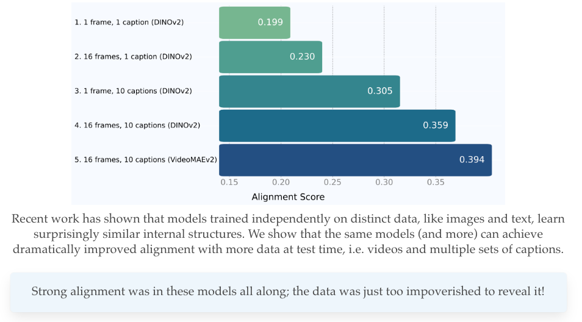

# Dynamic Reflections: Probing Video Representations with Text Alignment

[](https://arxiv.org/abs/2511.02767)
[](https://video-prh.github.io/)

[**Overview**](#overview) | [**Installation**](#installation) |
[**Quick Start**](#quick-start) | [**Reproduction**](#full-reproduction) |
[**Custom Models**](#custom-models)



This repository provides the official implementation for the paper "Dynamic
Reflections: Aligning Vision and Language Models through Temporal Representation
Learning". We provide the necessary code to reproduce our key findings on
video-text representation alignment.

## Overview

The core idea of our work is to measure and improve the alignment between video
and language representations. This codebase allows you to:

* Extract features various video and language models on datasets like VaTeX and PVD.
* Measure alignment between these representations using metrics like mutual k-NN.
* Experiment with different model architectures, pooling strategies, and temporal dynamics.

The project is structured to be extensible, allowing you to easily add your own
models and datasets.

## Installation

We recommend using `uv` for managing dependencies.

1.  **Initialize and sync the environment:**

    ```bash
    git clone git@github.com:google-deepmind/platonic-rep-video.git
    cd platonic-rep-video
    uv init
    uv sync
    ```

1.  **Install `ffmpeg`:** `ffmpeg` is required for video processing with
    `torchcodec`. We recommend installing it via `conda`.

    ```bash
    conda install ffmpeg
    ```

Our setup is tested with CUDA 12.4. If you are using a different CUDA version,
please adjust the `torch` and `torchvision` versions in `pyproject.toml`
accordingly.

## Data

We provide support for two datasets: VaTeX and PVD.

### VaTeX

Instructions for downloading VaTeX can be found
[here](https://eric-xw.github.io/vatex-website/download.html). We do not provide
the videos, but we provide a lightly processed subset of 1024 examples of the
`train` annotations which we use for our analysis for reproducibility.

Our dataloaders may need modifications depending on how the final videos are
downloaded. We recommend processing the videos to speedup feature extraction.

### Perception Encoder Video Dataset (PVD)

Instructions for downloading PVD can be found
[here](https://huggingface.co/datasets/facebook/PE-Video). Similarly to VaTeX,
we provide a lightly processed subset of 1024 examples of the `test` annotations
which we used for our analysis. We also include our Gemini-2.5-Pro rephrased
captions, which expand each model caption with 10 individual captions in a
similar format to VaTeX.

We also provide a script for downloading the videos from huggingface in
`misc/download_pvd.py` which is compatible with our dataloaders.

## Quick Start

The easiest way to get started is to run the provided `pvd_sample` experiment.
This will extract features for a small set of models on a sample of the VaTeX
dataset. Our configs are located in `configs/experiments`.

1.  **Run feature extraction:** We recommend extracting language and vision
    features separately. LLMs are automatically sharded across all available
    devices, while most video models should fit on one GPU. We speed this up by
    parallelizing multiple video models across devices, which makes it
    incompatible to run language and video feature extraction together. Use the
    appropriate flag for each modality.

    ```bash
    # Extract language features
    uv run scripts/main_extract.py pvd_sample --llm_only

    # Extract vision features
    uv run scripts/main_extract.py pvd_sample --video_only
    ```

    For multi-GPU execution, you can use the `launcher.py` script to parallelize
    feature extraction (recommended for vision models):

    ```bash
    uv run scripts/launcher.py pvd_sample --num-gpus 4 --video_only
    ```

    Extracted features will be saved to the `./results/sample/pvd/` directory
    by default. You may need to modify if you use `python` instead of `uv`.

1.  **Measure and plot alignment:** Once features are extracted, you can measure
    the alignment between them:

    ```bash
    uv run scripts/measure_alignment.py pvd_sample
    uv run scripts/plot_alignment.py pvd_sample
    ```

    This will compute the alignment scores and save the results to
    `./results/alignment/sample/`.

The same is possible for the VaTeX dataset using the `vatex_sample` config.
The only difference is the data will need to be obtained according to
the original instructions. Our provided dataloader will not work
out of the box, as we preprocess out data into pickle files first.

## Full Reproduction

To evaluate alignment on the full PVD dataset, you first need to run the
`vatex` experiment to extract features for all models.

```bash
# Extract language features (No parallelization as LLMs are sharded by default)
uv run scripts/main_extract.py pvd --llm_only

# Extract vision features (multi-GPU)
uv run scripts/launcher.py --num_gpus 8 pvd --video_only
```

After extraction, run the `measure_alignment.py` script with the same config,
and optionally plot the data as well.

```bash
uv run scripts/measure_alignment.py pvd
uv run scripts/plot_alignment.py pvd
```

The same is possible for the VaTeX dataset using the `vatex` config.

Finally, we also provide our retrieval accuracies for the video models on
Kinetics-400 and SSv2, which should be enough to fully reproduce Figure 2 of our
paper.

## Custom Models

This project uses a modular, registry-based system to handle video and language
models, making it easy to experiment with different architectures. Here are the
core components:

*   **Model Registries (`LLM_REGISTRY`, `VIDEO_MODEL_REGISTRY`)**: Central
    dictionaries in `registry/llm.py` and `registry/video.py` that hold all
    available models. Each model is mapped to a unique string name (e.g.,
    `'gemma2-2b-it'`, `'videomaev2_base'`), allowing you to reference them
    easily in your experiment configurations.

*   **`@register` Decorator (for Video Models)**: A Python decorator that
    simplifies adding new video models. By decorating a model's class with
    `@register('your-model-name')`, you automatically add it to the
    `VIDEO_MODEL_REGISTRY`.

*   **`VideoModelInterface` (Abstract Base Class)**: This class in
    `registry/video.py` defines a standard contract for all video models for
    functions like `initialize`,`preprocess`, and `forward_intermediates`.

### Adding a Language Model

To add a new language model, add an entry to the `LLM_REGISTRY` dictionary in
`registry/llm.py`. You'll need to provide a unique name for your model and an
`LLMConfig` instance pointing to its Hugging Face identifier.

```python
# In registry/llm.py

LLM_REGISTRY = {
    # ... existing models
    "my-custom-llm": LLMConfig(
        model_name="my-hf-organization/my-custom-llm-model",
        short_name="my-custom-llm",
        # Set the pad_token if necessary
        # pad_token="[PAD]",
    ),
    # ...
}
```

### Adding a Video Model

Adding a video model is slightly more involved, as video models tend to have
many specialized processing components.

**1. Define and Register the Model Class**

In `registry/video.py`, create a new class that inherits from the most
appropriate base class (`HuggingFaceModelBase`, `TimmModelBase`, or
`TimmImageAsVideoModelBase`) and decorate it with the `@register` decorator.
Below is an example:

```python
# registry/video.py

@register("my_awesome_video_model")
class MyAwesomeVideoModel(HuggingFaceModelBase):
    def __init__(self, short_name: Optional[str] = None):
        super().__init__(
            VideoModelConfig(
                # The full model name from the Hugging Face Hub or timm
                model_name="hf-hub-username/my-awesome-video-model",
                short_name="my-video-model",
                # --- Adjust configuration as needed ---
                # These values must match the model's requirements.
                clip_len=16,
                frame_sample_rate=2,
                native_num_frames=8,
                pool_types=["cls", "avg"],
            )
        )
    # --- Optional: Override methods for special cases ---
    # If your model requires custom logic for loading, preprocessing, or
    # feature extraction, you can override the base class methods.
```

You can test your model's implementation with `uv run registry/video.py`.

**2. Use the Model in an Experiment**

Once your model is registered, you can use it in any experiment config file
(e.g., `configs/vatex_sample.py`) by adding its registered name to
the `llm_names` or `video_model_names` list in the `ScriptArgs`.

```python
# In an experiment file

config = (
    "Sample experiment with a custom model.",
    ScriptArgs(
        # ...
        video_model_names=[
            "videomaev2_base",
            "my_awesome_video_model", # <-- Your newly added model
        ],
        llm_names=[
            "gemma2-9b-it",
            "my-custom-llm", # <-- Your newly added model
        ]
        # ...
    ),
)
```

Then you can proceed as above again for feature extraction and alignment.

## Citation

If you find our work useful, please cite our paper.

```
@misc{zhu2025dynamic,
    title={Dynamic Reflections: Probing Video Representations with Text Alignment},
    author={Tyler Zhu and Tengda Han and Leonidas Guibas and Viorica Pătrăucean and Maks Ovsjanikov},
    journal={arXiv preprint arXiv:2511.02767},
    year={2025},
}
```

Additionally, if this repository is useful, please also cite the original PRH
authors from whom this repository is based on (https://github.com/minyoungg/platonic-rep).

```
@inproceedings{huh2024prh,
    title={The Platonic Representation Hypothesis},
    author={Huh, Minyoung and Cheung, Brian and Wang, Tongzhou, and Isola, Phillip},
    booktitle={International Conference on Machine Learning},
    year={2024}
}
```

## License and disclaimer

Copyright 2026 Google LLC

All software is licensed under the Apache License, Version 2.0 (Apache 2.0); you
may not use this file except in compliance with the Apache 2.0 license. You may
obtain a copy of the Apache 2.0 license at:
https://www.apache.org/licenses/LICENSE-2.0

All other materials are licensed under the Creative Commons Attribution 4.0
International License (CC-BY). You may obtain a copy of the CC-BY license at:
https://creativecommons.org/licenses/by/4.0/legalcode

Unless required by applicable law or agreed to in writing, all software and
materials distributed here under the Apache 2.0 or CC-BY licenses are
distributed on an "AS IS" BASIS, WITHOUT WARRANTIES OR CONDITIONS OF ANY KIND,
either express or implied. See the licenses for the specific language governing
permissions and limitations under those licenses.

This is not an official Google product.
